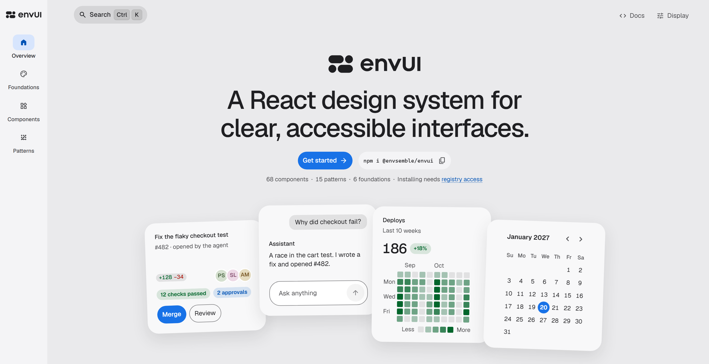
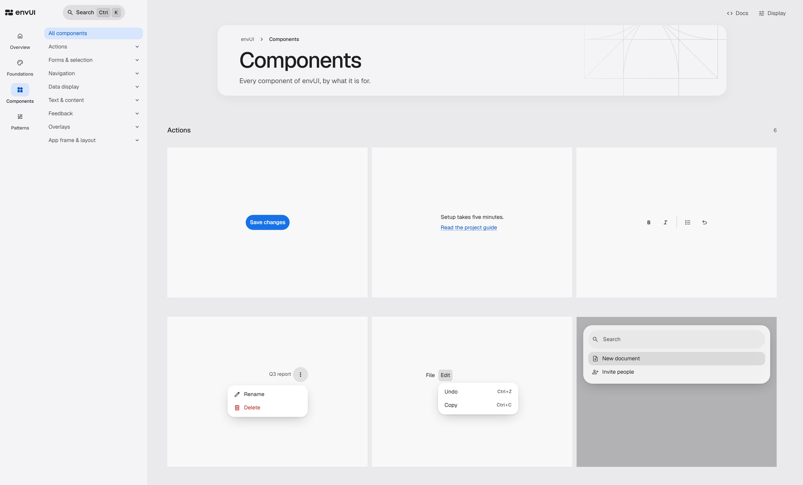

<picture>
  <source media="(prefers-color-scheme: dark)" srcset="assets/brand/envUI/envui-horizontal-on-dark.svg">
  
</picture>

**A React design system for clear, accessible interfaces.**

[](https://github.com/envsemble/envUI/actions/workflows/verify.yml)


[](https://www.npmjs.com/package/@envsemble/envui)


envUI gives B2B SaaS products and AI developer tools one consistent interface: themes, components and patterns, from a button or a form to an app frame, a data table or a conversation with an agent. Its documentation is written for the people and the coding agents who build with it, and ships in the package.

[Website](https://envui.envsemble.com) · [Docs](https://envui.envsemble.com/docs) · [Changelog](packages/ui/CHANGELOG.md) · [Contributing](CONTRIBUTING.md)

<picture>
  <source media="(prefers-color-scheme: dark)" srcset="assets/readme/overview-dark.png">
  
</picture>

## Get started

Install it from npm with `npm install --save-exact @envsemble/envui`. [Install and set up](https://envui.envsemble.com/docs/setup) walks through the rest: styles, theme and router. A coding agent can do the setup with you from one prompt:

```text
Set up envUI in my app: envui.envsemble.com/SKILL.md
```

For an app that already has an interface of its own, read [Move an app to envUI](https://envui.envsemble.com/docs/migration) first.

## What’s inside

- **Foundations:** light, dark and high-contrast themes, design tokens, typography, spacing and density.
- **Components:** actions, navigation, native form controls, selection, data display, dialogs and notifications, with Base UI under the complex interactions.
- **Patterns:** components put together for what people do, such as forms, settings, data tables, app frames and conversations.
- **Content:** Markdown, code highlighting, diffs and Tiptap rich text, on entry points of their own.
- **Local assets:** the Geist fonts and Material Symbols Rounded icons ship in the package, with no CDN.
- **Dev mode:** a page's layout described as text for agents and taken apart in 3D for people, from `@envsemble/envui/dev`.
- **Lint rules:** an [ESLint plugin and a Stylelint config](https://envui.envsemble.com/docs?section=lint-rules) that name the envUI component or token to use instead of hand-built controls and raw colors.

<picture>
  <source media="(prefers-color-scheme: dark)" srcset="assets/readme/gallery-dark.png">
  
</picture>

## Documentation

The [website](https://envui.envsemble.com) has two parts. The catalogue shows every foundation, component and pattern, live. The [Docs](https://envui.envsemble.com/docs) are the developer reference: setup, guides, props, part names and the changelog. The same pages ship in the package under `docs/`, so an agent reads the ones for the version it has installed.

## Contributing

To work on envUI itself, start with [CONTRIBUTING.md](CONTRIBUTING.md).

## Versions and license

A published version never changes, and breaking changes come only in a new major version. Prereleases are published under the `prerelease` dist-tag, and stable releases under `latest`.

envUI is proprietary and distributed privately. Bundled third-party assets and dependencies keep their [notices](packages/ui/THIRD_PARTY_NOTICES.md) and [licenses](packages/ui/licenses/).
