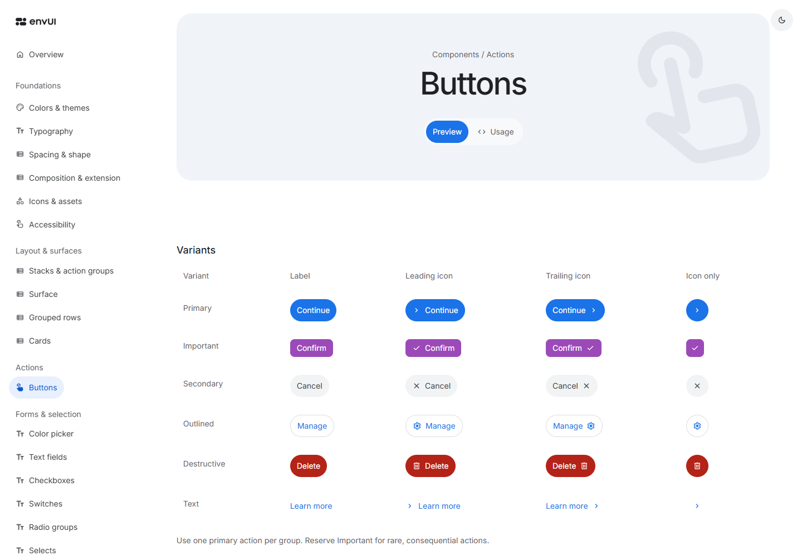
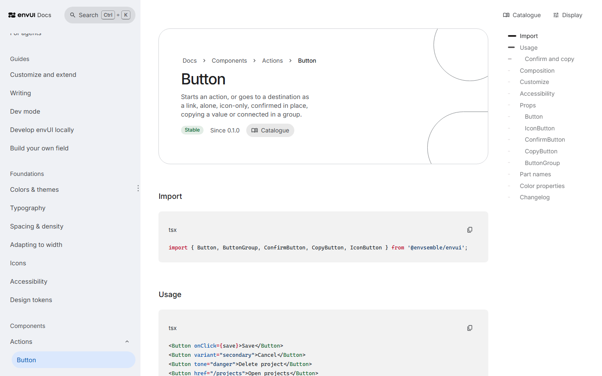

<picture>
  <source media="(prefers-color-scheme: dark)" srcset="assets/brand/envUI/envUI-lockup-white.svg">
  
</picture>

**The shared interface library for envsemble.**

[](https://github.com/envsemble/envUI/actions/workflows/ci.yml)


envUI brings consistent themes, composition and interaction to React applications: from a button or a native form to dialogs, notifications and rich text. It ships as a private ESM package with TypeScript declarations, local fonts, icons and documentation that people and coding agents read alike.

[Set up](docs/setup.md) · [For agents](docs/agent-tooling.md) · [Migrate an app](docs/migration.md) · [Dev mode](docs/dev-mode.md) · [Changelog](packages/ui/CHANGELOG.md)

<picture>
  <source media="(prefers-color-scheme: dark)" srcset="assets/readme/catalogue-dark.png">
  
</picture>

_The catalogue: every component, pattern and foundation with live examples, and when to use each. The picture follows your light or dark appearance._

## What’s inside

- **Foundations:** scoped light, dark and high-contrast themes, design tokens, Inter, typography, spacing and density, surfaces and layout primitives.
- **Everyday interactions:** actions, navigation, native form controls, selection, color picking, dialogs and toasts, with Base UI underpinning complex interactions.
- **Patterns:** forms and validation, settings, app frames, conversations and more, each composed from the components.
- **Content tools:** Markdown, code highlighting and Tiptap rich text on separate entry points.
- **Local assets:** Inter and the official Material Symbols Rounded icons, with no font or icon CDN required.
- **Dev mode:** a page's layout described and checked as text for agents, and taken apart in 3D for people, from its own entry point, `@envsemble/envui/dev`.
- **A website in two parts:** the catalogue shows each component, pattern and foundation to people, and the Docs at `/docs` are the developer reference: setup, guides, props, part names and the changelog. Each page links to its counterpart in the other part.

<picture>
  <source media="(prefers-color-scheme: dark)" srcset="assets/readme/docs-dark.png">
  
</picture>

_The Docs: setup, guides and every component's props, part names and changelog._

## Start using envUI

Requires React and React DOM 19, Node.js 22.13 or a later 22 release, or Node.js 24 or newer, for the `envui` command and the lint packages, plus access to the private `@envsemble` GitHub Packages registry. See [setup](docs/setup.md) for registry access and the [documentation index](docs/index.md) for examples matching the installed version.

```sh
npm install --save-exact @envsemble/envui@<version>
```

Upgrading an application from envUI 0.x to 1.0? The `@envsemble/envui-codemods` package moves its imports, components, props, types and `env-*` classes to the 1.0 names and reports what needs a decision. Commit first, then run the seven transforms in this order, before installing 1.0:

```sh
npx @envsemble/envui-codemods@<version> v1-names src
npx @envsemble/envui-codemods@<version> v1-structure src
npx @envsemble/envui-codemods@<version> v1-render src
npx @envsemble/envui-codemods@<version> v1-stack src
npx @envsemble/envui-codemods@<version> v1-props src
npx @envsemble/envui-codemods@<version> v1-entries src
npx @envsemble/envui-codemods@<version> v1-classes src
```

The [migration guide](docs/migration.md), under "Upgrade from envUI 0.x to 1.0", explains each step, what the codemods leave to you and the renamed tokens.

Import the stylesheet once at your application entry point, then compose public components:

```tsx
import { Button, Card, Column, Text, Theme } from '@envsemble/envui';
import { Add } from '@envsemble/envui/icons/Add';
import '@envsemble/envui/styles.css';

export function App() {
  return (
    <Theme theme="light">
      <Card render={<article />}>
        <Column gap={3}>
          <Text render={<h1 />} variant="headline">
            Projects
          </Text>
          <Text emphasis="muted">A shared space for your team’s work.</Text>
        </Column>
        <Button startIcon={<Add />}>Create project</Button>
      </Card>
    </Theme>
  );
}
```

Native form behavior stays familiar. Render this inside your application’s theme:

```tsx
import { Button, Column, Row, TextField } from '@envsemble/envui';

export function ProjectForm() {
  return (
    <Column gap={4} render={<form />}>
      <TextField name="projectName" label="Project name" required />
      <Row wrap align="center" gap={4}>
        <Button type="submit">Create project</Button>
        <Button type="reset" variant="secondary">
          Reset
        </Button>
      </Row>
    </Column>
  );
}
```

| Entry point                   | Use it for                          |
| ----------------------------- | ----------------------------------- |
| `@envsemble/envui`            | Foundations and everyday components |
| `@envsemble/envui/icons/Name` | Individual icon imports             |
| `@envsemble/envui/content`    | Markdown, code and Markdown editing |
| `@envsemble/envui/rich-text`  | Rich-text rendering and editing     |
| `@envsemble/envui/dev`        | Dev mode, in development only       |
| `@envsemble/envui/styles.css` | Shared styles and local font        |

## Working with agents

Coding agents get the same documentation as people. Give one this prompt to set envUI up in an application:

```text
Set up envUI in my app: envui.envsemble.com/SKILL.md
```

It follows the setup skill the site hosts: after a short checklist, it installs envUI with its styles and theme, adds a few lines to the project's `AGENTS.md` that point agents to the docs in the package, and turns on the ESLint and Stylelint rules (`@envsemble/eslint-plugin-envui`, `@envsemble/stylelint-config-envui`), which flag hand-built controls and raw colors. [For agents](docs/agent-tooling.md) describes it.

Documentation ships under `node_modules/@envsemble/envui/docs/`. Each component, pattern and foundation is one Markdown page, the same file the catalogue and the Docs are built from: what it is, its variants, anatomy and behaviour, its rules, accessibility and words to use, then how to compose it in code, with its props and part names generated from the public TypeScript declarations. The example files are in `docs/examples/`, and every export’s props in `docs/generated/props.json`. Edit the maintained pages under `docs/`, as [the component page guide](docs/component-pages.md) describes, and improve the relevant page as integrations reveal gaps.

## Versions and license

Published versions are immutable; breaking changes come in a new major version with migration notes. Prereleases are published under their own name as the dist-tag, such as `prerelease` for `1.0.0-prerelease.4` (`npm install @envsemble/envui@prerelease`), and stable releases under `latest`. The [changelog](packages/ui/CHANGELOG.md) describes each release.

envUI is proprietary and distributed privately. Bundled third-party assets and dependencies retain their [notices](packages/ui/THIRD_PARTY_NOTICES.md) and [licenses](packages/ui/licenses/).

## Develop envUI

To work on envUI itself, run its catalogue and checks, or host and release it, see [contributing](CONTRIBUTING.md).
